

# SFCC Lucky Draw

### US sweepstakes for SFRA with a free method of entry, verifiable draws and single-use coupon prizes

[Deployment](docs/DEPLOYMENT.md) · [Architecture](docs/ARCHITECTURE.md) · [API reference](docs/API_REFERENCE.md) · [Testing](docs/TESTING.md) · [Phase PRs](docs/DEVELOPMENT-PHASES.md)

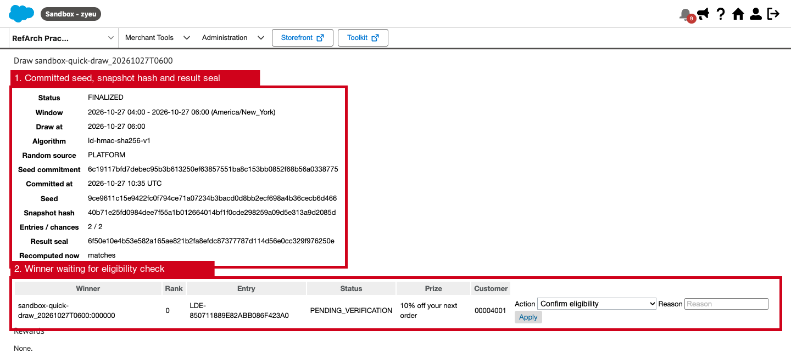

> **Status: sandbox and demo only. Legal approval is mandatory before production activation.** It is unit-tested, and a demonstration campaign ran end to end on a sandbox on 2026-10-27 (see the [Feature guide](#feature-guide)). On a production instance, no campaign can be scheduled until `luckyDrawLegalApproved` is set. Every campaign also needs its own legal approval reference. On other instances, campaigns are labelled as demonstrations. See [Production blockers](#production-blockers).

`plugin_luckydraw` runs promotional campaigns in the United States, in USD:

- **Sweepstakes mode:**
  - Paid orders above a minimum earn entries.
  - A free alternative method of entry is always available: online, once signed in, and by mail through customer service.
  - A job draws winners at fixed times in the campaign's time zone, using cryptographically secure randomness.
  - Anyone can verify each draw afterwards.
- **Guaranteed mode:** for places where purchase-linked chance promotions are not allowed. Every qualifying entry receives the reward, and no chance is involved.
- **Rewards:** single-use coupon codes of an existing Business Manager promotion. Only the winner can use the code, and only until it expires.
- **Shoppers can:**
  - see campaign details, eligibility, the next draw with a countdown, and their own entries and rewards;
  - see masked past winners ("A. (TX)");
  - read the official rules and the draw verification data;
  - leave a campaign.
- **Administrators** in Business Manager:
  - create campaigns and schedule them; scheduling freezes the rules;
  - pause, resume or cancel campaigns;
  - confirm or disqualify winners (an alternate takes over a disqualified prize);
  - review fraud flags and cases;
  - read the audit trail.

## Feature guide

Screenshots from sandbox `zyeu-002` (site `RefArch_Practice`), taken on 2026-10-27, for the demonstration campaign `sandbox-quick-draw`. The numbered red boxes mark the feature each section describes.

### Campaign set-up in Business Manager

A campaign needs the following before **Readiness** allows scheduling:
- an online official-rules content asset and its version
- a legal approval reference
- an allowed time zone and countries
- prizes whose coupon is a single-use, multi-code coupon

Scheduling freezes the rules.

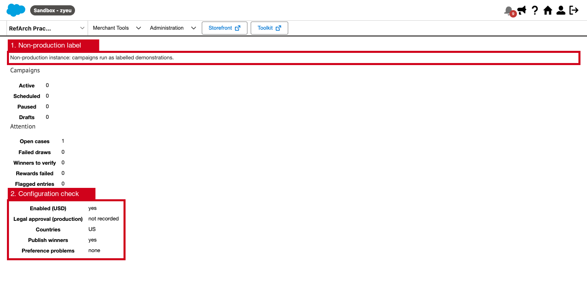

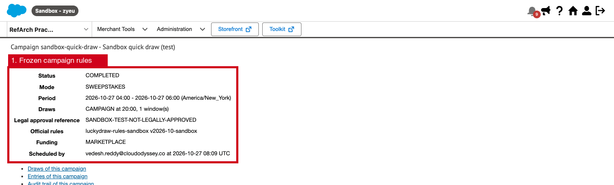

### The campaign page

The page shows:
- the "no purchase necessary" notice, the eligibility rules and a link to the official rules
- how to take part, the prizes and the draw schedule
- while the campaign runs: a countdown and the free entry form, limited to once a day

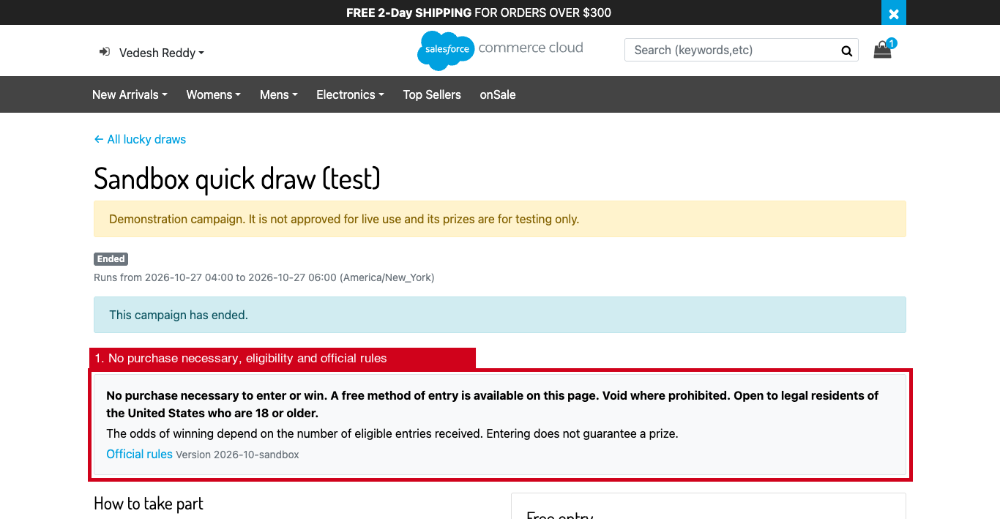

### Entries

Paid orders earn entries once the `LuckyDraw-Entries` job sees them. Free entries count the same.

An order outside the campaign period, or with a billing address outside the eligible regions, earns no entry. The job status counts the reasons, for example `{"region":2,"outside-campaign":1}`.

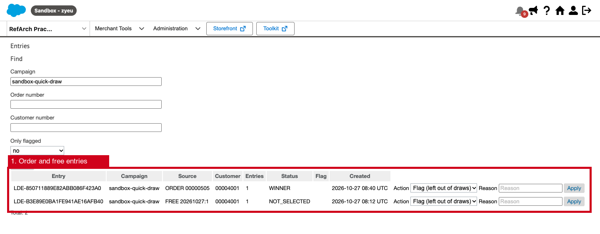

### A verifiable draw

The `LuckyDraw-Draw` job works in three steps:
1. It commits to a secret seed before the draw.
2. It hashes the snapshot of entries.
3. It selects winners with `ld-hmac-sha256-v1` and seals the result.

**Recomputed now** repeats the selection from the published inputs and must show **matches**. The winner then waits for an eligibility check.

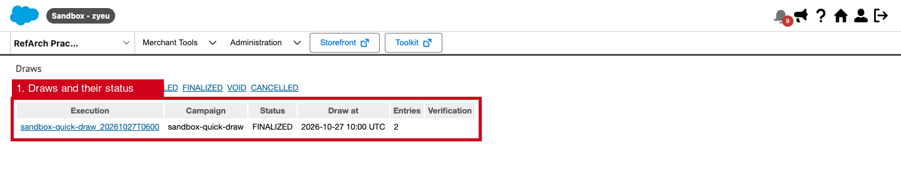

### Rewards

After **Confirm eligibility**, the `LuckyDraw-Rewards` job issues a single-use code from the prize coupon. Only the winner sees it, under **My rewards**.

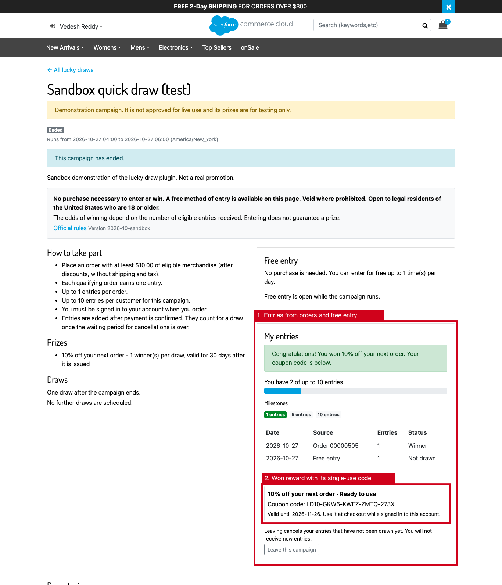

The code works in the cart like any coupon. Here it applies the 10% prize promotion.

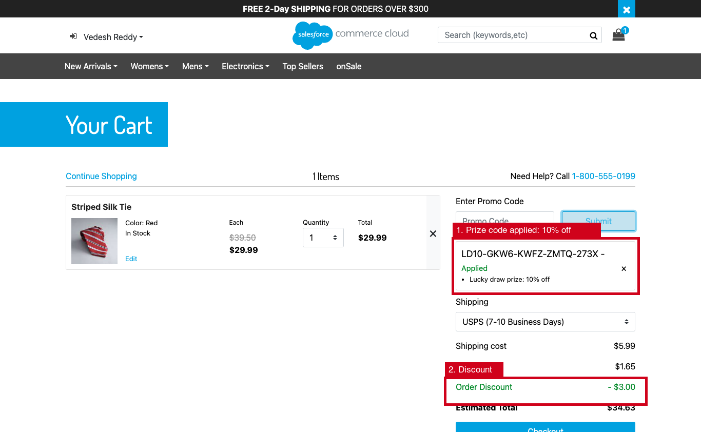

Another shopper cannot use the code.

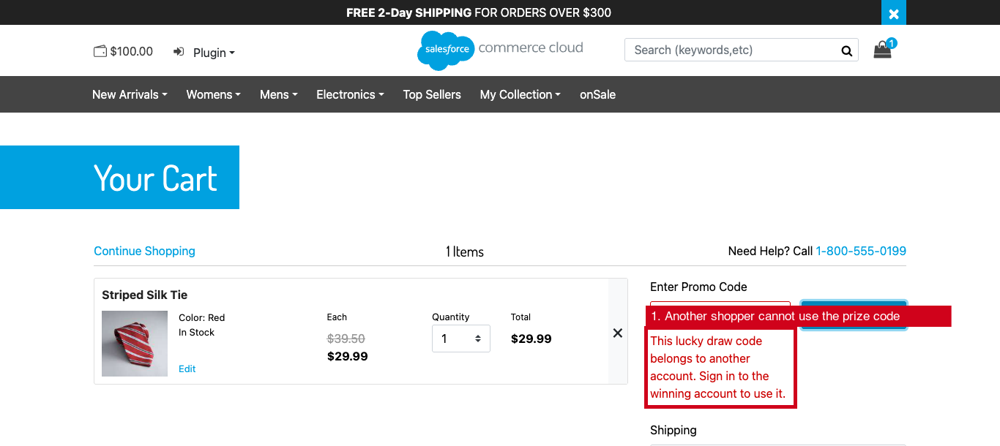

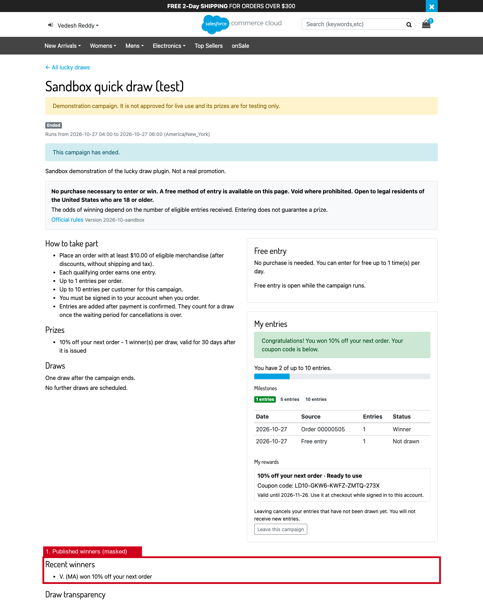

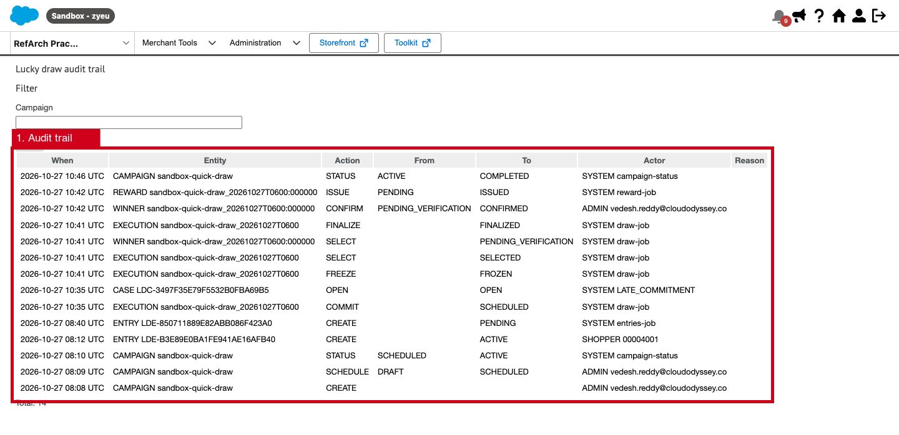

## Contents of the plugin

| Path | Contents |
|---|---|
| `cartridges/plugin_luckydraw` | Storefront cartridge: pages `LuckyDraw-*`, coupon checks on `Cart-AddCoupon` and `CheckoutServices-PlaceOrder`, Custom SCAPI APIs `luckydraw` and `luckydraw-admin`, 9 job steps |
| `cartridges/bm_luckydraw` | Business Manager cartridge: Merchant Tools › Lucky Draw (5 permission-scoped modules) |
| `metadata/plugin_luckydraw` | Site import: 13 custom object types, 24 site preferences, 9 jobs, 1 service, sandbox preference values |
| `test/plugin_luckydraw` | 80 unit tests (Node + mocha with an in-memory Script API double) |
| `docs` | This documentation |

## Documentation

| Document | Contents |
|---|---|
| [ARCHITECTURE.md](docs/ARCHITECTURE.md) | Components, entry pipeline, draw algorithm, rewards, concurrency |
| [BUSINESS_FLOWS.md](docs/BUSINESS_FLOWS.md) | Campaign, entry, draw, winner and reward flows, with state machines |
| [CONFIGURATION.md](docs/CONFIGURATION.md) | Site preferences and every campaign setting |
| [METADATA.md](docs/METADATA.md) | Custom objects, jobs and services |
| [API_REFERENCE.md](docs/API_REFERENCE.md) | Controllers, Custom APIs and extension hooks |
| [SECURITY.md](docs/SECURITY.md) | Fairness, fraud controls, data protection, compliance and production blockers |
| [TESTING.md](docs/TESTING.md) | What is tested, how to run it, and the sandbox test plan |
| [DEPLOYMENT.md](docs/DEPLOYMENT.md) | Install, configure and enable the plugin |
| [ROLLBACK.md](docs/ROLLBACK.md) | Pause, disable or remove it safely |

## Quick start (sandbox)

1. Deploy `plugin_luckydraw` and `bm_luckydraw`, then add them to the cartridge paths: `plugin_luckydraw:app_storefront_base` for the storefront, and `bm_luckydraw:plugin_luckydraw` for Business Manager.
2. Import `metadata/plugin_luckydraw` as a site archive. Rename `sites/RefArch` to your site ID first.
3. Set the password of the service `plugin-luckydraw.hmac` to a random value of at least 32 characters.
4. Create the reward promotion with a system-codes coupon whose redemption limit per code is 1. Also create a content asset holding the official rules.
5. In Merchant Tools › Lucky Draw › Campaigns, create a draft, check its readiness, and schedule it.
6. Enable the jobs and open `LuckyDraw-Show`.

The full procedure is in [DEPLOYMENT.md](docs/DEPLOYMENT.md).

## Production blockers

All are open. They are explained in [SECURITY.md](docs/SECURITY.md#production-blockers).

1. **Legal review of every campaign.** This covers US sweepstakes and lottery law (federal and state), the official rules, the free method of entry, and the excluded states. It also covers prize registration and bonding where required (historically Florida and New York for prizes above $5,000), tax reporting of prizes (1099-MISC at $600 or more), age limits and privacy. Record the approval in the campaign's legal approval reference. On production, record it also in `luckyDrawLegalApproved`.
2. **Equal dignity of the free entry.** Legal must confirm that the free method of entry is as easy to use, and gives the same chances, as the purchase method. Typical settings are `freeEntryWeight` = entries per order, and a limit per day.
3. **Winner verification process.** Decide whether to use affidavits, identity and age checks, and how to collect tax forms. Keep `requireWinnerVerification` on until that process exists.
4. **Randomness source.** For high-value prizes, decide whether a third-party draw service or a public randomness beacon is required (`randomSource = EXTERNAL`, hook `app.plugin.luckydraw.randomness`).
5. **Scale.** For campaigns that may exceed `luckyDrawMaxSnapshotEntries` entries per draw, or custom object quotas, use an external campaign store (see [ARCHITECTURE.md](docs/ARCHITECTURE.md#limitations)).
6. **Sandbox verification.** L1 to L4, L7 and L8 passed on `zyeu-002` on 2026-10-27, and all nine jobs ran OK. L5, L6, L9 and L10 remain open; see [TESTING.md](docs/TESTING.md#sandbox-verification-plan).
